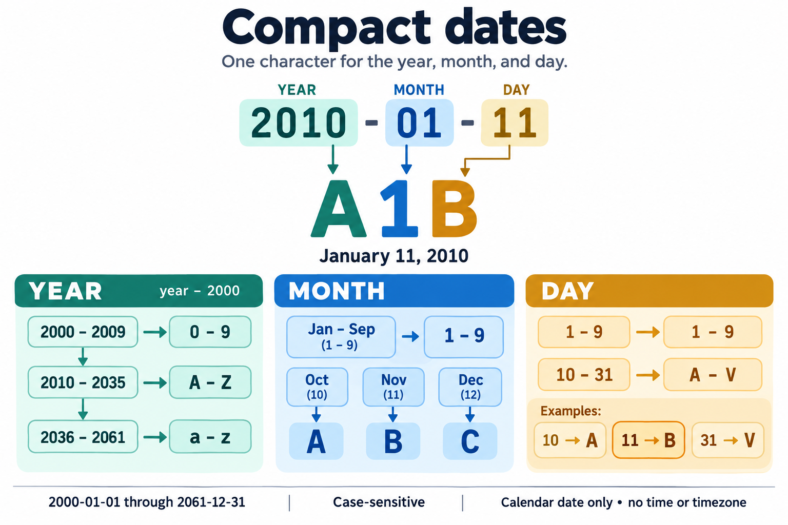

# cdate and ddate

A compact date stores the year, month, and day in three case-sensitive characters, one for each field.



For example, `A1B` means January 11, 2010: `A` is the year 2010, `1` is January, and `B` is day 11. Digits, uppercase letters, and lowercase letters let the format cover dates from 2000-01-01 through 2061-12-31.

`cdate` converts a date to this compact format. `ddate` decodes it and formats the result with the installed `date` command.

```sh
cdate 2010-01-11                      # A1B
cdate 20100111                        # A1B
cdate January 11, 2010                # A1B
cdate -u 2010-01-11T13:41:54Z          # A1B
ddate A1B +%F                         # 2010-01-11
ddate -u A1B '+%A, %B %d, %Y'          # Monday, January 11, 2010
```

Run `cdate` without input to encode today in UTC. Input and output time zones default to UTC when none is supplied. `-l` or `--local` changes only the output zone to the system's local time or the `TZ` environment variable. `--input-local` changes input interpretation. Use both flags to interpret and output a local calendar day.

Named zones have the same separation, with `--input-timezone ZONE` for input and `-z ZONE` for output. `ddate` can also take a zone with its code; an explicit input flag overrides that zone.

## Implementations and installation

The repository contains two implementations with the same CLI and shared compatibility tests:

- [TypeScript](impl_ts/README.md): independent executable files in `impl_ts/`, requiring Node.js 22.18 or newer. Run them directly; no build is needed.
- [Rust](impl_rust/README.md): native executables built from `impl_rust/`, requiring Rust only at build time. Release builds prioritize binary size.

Both need a GNU-compatible `date` on `PATH`, supporting `--date`, percent directives, and the output modes you use, plus Unix time-zone data. Tests use uutils coreutils 0.8.0. BSD/macOS `date` lacks the required interface; install GNU coreutils and put its `date` on `PATH`.

Run either implementation from the repository root:

```sh
./impl_ts/cdate 2010-01-11                     # A1B
./impl_ts/ddate A1B +%F                        # 2010-01-11

timeout 60s cargo build --manifest-path impl_rust/Cargo.toml --release --locked
./impl_rust/target/release/cdate 2010-01-11     # A1B
./impl_rust/target/release/ddate A1B +%F        # 2010-01-11
```

Examples elsewhere in this README use `cdate` and `ddate` on `PATH`. See each implementation's README for installation commands. Installing one implementation replaces commands with the same names in the destination; preserve an older installation first if needed. Building or running this repository does not modify existing commands elsewhere.

The shared [cdate man page](man/cdate.1) and [ddate man page](man/ddate.1) apply to either implementation. Read them locally or install them for `man cdate` and `man ddate`:

```sh
man -l man/cdate.1
man -l man/ddate.1
mkdir -p "$HOME/.local/share/man/man1"
install -m 644 man/cdate.1 man/ddate.1 "$HOME/.local/share/man/man1/"
```

If your `man` configuration does not search that directory, use `man -M "$HOME/.local/share/man" cdate`, or add it to your configured manual search path.

## The encoding

All three positions use this alphabet, indexed from zero:

```text
0123456789ABCDEFGHIJKLMNOPQRSTUVWXYZabcdefghijklmnopqrstuvwxyz
```

The first character is the index `year - 2000`. The second is the month number, from 1 through 12. The third is the day number, from 1 through 31. This is a separate field encoding, rather than a single base-62 integer.

- Years 2000–2009 use `0`–`9`, years 2010–2035 use `A`–`Z`, and years 2036–2061 use `a`–`z`.
- Months January–September use `1`–`9`; October, November, and December use `A`, `B`, and `C`.
- Days 1–9 use `1`–`9`; days 10–31 use `A`–`V`.

For `A1B`, `A` means 2010, `1` means January, and `B` means day 11. The earliest code is `011`; the latest is `zCV`. There are 22,646 valid codes. Case matters: `A11` is 2010-01-01, while `a11` is 2036-01-01.

Every code must describe an existing calendar date. `A2T` would mean 2010-02-29 and is rejected. `C2T` means 2012-02-29 and is valid. Zero is allowed in the year position, but neither month nor day can be zero.

No time, offset, time-zone name, or original input format is stored. Decoding recovers the calendar day, assumes midnight in the input zone, and displays that instant in the output zone.

## cdate input and options

```text
cdate [OPTIONS] [DATE OR TIMESTAMP ...]
```

Positional words are joined with spaces, so both `cdate January 11, 2010` and `cdate 'January 11, 2010'` work. Supply one date expression. `--date STRING` is an alternative to positional input.

| Option | Behavior |
| --- | --- |
| `-h`, `--help` | Print usage and all options, then succeed without reading reference files, running `date`, or creating logs. |
| `-V`, `--version` | Print `cdate 1.0.0` without operational side effects. |
| `-d`, `--debug` | Create a private execution log in the current directory. |
| `--date STRING` | Use the supplied date expression instead of positional words. |
| `-i`, `--input-format FORMAT` | Choose `auto`, `ymd`, `mdy`, `dmy`, `unix`, `unix-ms`, `date`, or `javascript`. Default: `auto`. |
| `-r`, `--reference FILE` | Encode the last modification instant of a file in the output zone. |
| `-u`, `--utc`, `--universal` | Select UTC for the encoded calendar day. Output default. |
| `-l`, `--local` | Select the inherited system/`TZ` local zone for the encoded day only. |
| `-z`, `--timezone ZONE` | Select a named IANA zone for the encoded day only. |
| `--input-utc` | Interpret unzoned input in UTC. Input default. |
| `--input-local` | Interpret unzoned input in the inherited system/`TZ` local zone. |
| `--input-timezone ZONE` | Interpret unzoned input in a named IANA zone. |

Select at most one output-zone option and at most one input-zone option. Options from different groups can be combined, such as `--input-local --utc` or `--input-timezone Asia/Tokyo --local`. `--reference` cannot be combined with a date input; an explicit input format requires an input. Options are singletons, including aliases: `--utc -u` is an error. `--date` is long-only because `-d` means debug in these tools.

### Automatic detection

`auto` recognizes these forms before using the installed `date` parser for other expressions:

| Input | Interpretation |
| --- | --- |
| `2010-01-11`, `2010/01/11`, `2010.01.11` | Midnight on the supplied calendar day in the input zone. |
| `20100111` | Eight-digit `YYYYMMDD`. |
| `2010`, `2010-01` | Midnight on the first day of the ISO year or year-month in the input zone. |
| `2010-01-11T13:41:54Z` | A UTC instant, then converted to the output zone. |
| `2010-01-11T13:41:54+05:30` | An instant with an explicit numeric offset. |
| `2010-01-11T13:41:54.123456789Z` | Fractional seconds, with up to nine digits. |
| `2010-01-11T13+05`, `2010-01-11T13:41+05:30` | Hour/minute precision, including `date -Ihours` output. |
| `01/11/2010`, `01/11/10` | Month/day/year unless the first field exceeds 12. |
| `13/01/2010` | Day/month/year, since 13 cannot be a month. |
| `January 11, 2010`, `11 Jan 2010` | English calendar expressions handled by `date`. |
| `Mon Jan 11 13:41:54 UTC 2010` | Standard English `date` output. |
| `Mon, 11 Jan 2010 13:41:54 +0000` | RFC email output from `date -R`. |
| `Mon Jan 11 2010 13:41:54 GMT+0000 (Coordinated Universal Time)` | Standard JavaScript `Date.toString()` output. |
| `1/11/2010, 1:41:54 PM` | Common numeric JavaScript locale output, with a validated 12-hour clock. |
| `@1263217314` | Unix seconds, independent of digit count. |
| `1263217314` | Ten-digit Unix seconds. |
| `1263217314000` | Thirteen-digit Unix milliseconds. |

Two-digit years in numeric month/day or day/month input follow the usual `date` window: 00–68 mean 2000–2068, and 69–99 mean 1969–1999. The compact output range still applies, so years outside 2000–2061 fail.

Other input, such as `today`, `yesterday`, `tomorrow`, `next Friday`, or `'2010-01-11 +1 day'`, is handled by the installed `date` parser in the input zone. Its accepted grammar and relative-date behavior can vary by implementation. Standard ISO 8601 and RFC 3339 output modes, RFC email output, JavaScript `toISOString()`, `toJSON()`, `toUTCString()`, `toString()`, and `toDateString()` are covered. Time-only expressions use the current day in the input zone because they contain no historical calendar date.

For ambiguous input, select a format:

```sh
cdate -i dmy 11/01/2010          # A1B, January 11
cdate -i mdy 11/01/2010          # AB1, November 1
cdate -i dmy 11012010            # A1B
cdate -i mdy 01112010            # A1B
cdate -i unix 1263217314         # A1B in UTC
cdate -i unix-ms 1263217314000   # A1B in UTC
```

`ymd`, `mdy`, and `dmy` require numeric calendar input, optionally followed by a time and zone. `date` delegates the input grammar directly to the system command, bypassing automatic numeric interpretation. For example, the installed `date` can interpret bare `2010` as 20:10 today, while `auto` treats it as 2010-01-01.

`unix` accepts up to nine fractional digits; `unix-ms` accepts up to six, preserving nanosecond precision during conversion. Epoch values use exact integer arithmetic. Scientific notation, infinity, trailing junk, and excess precision are rejected. In `auto`, ten- or thirteen-digit timestamps may also include fractions. Use an explicit epoch mode for other digit counts.

### Independent input and output zones

Both zones default to UTC, even when `TZ` names another zone. The input zone supplies the missing zone for unzoned calendar dates, clock times, and relative expressions. Named-zone aliases are resolved against available time-zone data so that the system parser receives a usable zone name. A date-only input means midnight in that input zone. The output zone then determines which calendar day gets encoded. Changing `--local`, `--utc`, or `--timezone` never changes input interpretation.

Explicit `Z`, numeric offsets, and zones recognized by the installed parser determine the input instant themselves. Input-zone options do not override them. Unix timestamps, file modification instants, and the current instant with no input also remain unchanged by input-zone options.

```sh
TZ=America/Los_Angeles cdate 2010-01-11T00:30:00Z          # A1B, January 11 in UTC
TZ=America/Los_Angeles cdate --local 2010-01-11T00:30:00Z  # A1A, January 10 locally
cdate -z Asia/Kolkata 2010-01-11T23:30:00Z                # A1C, January 12
```

Unzoned input can also move to another day during output conversion. With `TZ=America/Los_Angeles`, the combinations below show each flag's effect:

| Input | Flags | Input interpretation | Encoded output |
| --- | --- | --- | --- |
| `2010-01-11` | none | January 11, midnight UTC | `A1B`, January 11 UTC |
| `2010-01-11` | `--local` | January 11, midnight UTC | `A1A`, January 10 locally |
| `2010-01-11` | `--input-local --local` | January 11, local midnight | `A1B`, January 11 locally |
| `2010-01-11 23:30:00` | `--input-local` | January 11, 23:30 locally | `A1C`, January 12 UTC |
| `2010-01-11 23:30:00` | `--input-local --local` | January 11, 23:30 locally | `A1B`, January 11 locally |

For example, `cdate --input-timezone Asia/Tokyo 2010-01-11` encodes `A1A`: Tokyo midnight is January 10 at 15:00 UTC. Add `--timezone Asia/Tokyo` to output `A1B` instead.

### JavaScript semantics and clock validation

[`Date.parse` interprets ISO date-only strings as UTC, while an ISO date-time without an offset uses local time](https://tc39.es/ecma262/multipage/numbers-and-dates.html#sec-date.parse). Choose `-i javascript` to apply those semantics. The input zone supplies JavaScript's local-time interpretation for unzoned date-times; ISO date-only strings stay UTC even with `--input-local`. The output zone still controls the encoded day. Calendar validity is checked independently to reject invalid dates that JavaScript would otherwise roll into another month. TypeScript uses native `Date.parse`; Rust implements the standard ISO and English string behavior with the system parser. Nonstandard legacy JavaScript parsing can differ; prefer ISO strings for interchange.

```sh
TZ=America/Los_Angeles cdate 2010-01-11                         # A1B
TZ=America/Los_Angeles cdate --input-local --local 2010-01-11   # A1B
TZ=America/Los_Angeles cdate --input-local --local -i javascript 2010-01-11
# A1A: JavaScript interprets this ISO date-only string as UTC
```

Valid ISO `24:00`, with zero minutes, seconds, and fraction, denotes the end of a day and is normalized to the next day. `24:00:01`, leap-second notation, impossible calendar dates, and unzoned absolute times that round-trip to a different clock in the input zone due to a DST gap are rejected. For repeated clock times during a DST fall-back, the system parser chooses an occurrence; use an explicit offset when the instant matters.

The final selected day determines representability. For example, `1999-12-31T23:30:00-01:00` becomes 2000-01-01 in UTC and can be encoded. Conversely, converting a boundary instant into another zone can put it outside the range.

### Locale limits

English month names and ordinary numeric locale strings are supported. Unicode direction marks and common nonbreaking spaces are removed from numeric locale output before parsing. Arbitrary localized month names, non-Gregorian calendars, alternate digit systems, and custom formats cannot be autodetected reliably. JavaScript itself [does not require `Date.parse` to round-trip `toLocaleString()`](https://tc39.es/ecma262/multipage/numbers-and-dates.html#sec-date.parse).

Use ISO output for interchange, or select `mdy`/`dmy` for a numeric locale date. Localized standard `date` output is accepted when the installed parser understands it. Setting `LC_ALL=C` when producing textual `date` output makes its English form predictable.

## ddate output and options

```text
ddate [OPTIONS] CODE [ZONE] [+FORMAT]
ddate [OPTIONS] --date 'CODE [ZONE]' [+FORMAT]
```

`ddate` assumes midnight on the decoded calendar day in the input zone, then formats that instant in the output zone. An explicit `--input-*` option chooses the input zone. Otherwise, a zone supplied with the code chooses it; with neither, the input zone is UTC. The output zone defaults to UTC independently.

Without formatting options it uses `date`'s default output format. `--local` displays the assumed input midnight in local time; use `--input-local --local` to interpret and display a local midnight. `+%F` produces a stable `YYYY-MM-DD` result in the output zone.

| Option | Behavior |
| --- | --- |
| `-h`, `--help` | Print help and succeed without running `date` or creating logs. |
| `-V`, `--version` | Print `ddate 1.0.0` without operational side effects. |
| `-d`, `--debug` | Create a private execution log in the current directory. |
| `--date INPUT` | Supply the code and optional zone as one value instead of positional arguments. |
| `-u`, `--utc`, `--universal` | Display the result in UTC. Output default. |
| `-l`, `--local` | Display in the system/`TZ` local zone. Input interpretation is unchanged. |
| `-z`, `--timezone ZONE` | Display in a named IANA zone. Input interpretation is unchanged. |
| `--input-utc` | Reinterpret the decoded day as UTC midnight, overriding a supplied input zone. |
| `--input-local` | Reinterpret the decoded day as system/`TZ` local midnight, overriding a supplied input zone. |
| `--input-timezone ZONE` | Reinterpret the decoded day as midnight in a named IANA zone, overriding a supplied input zone. |
| `-I`, `--iso-8601[=FMT]` | ISO 8601 output; `date`, `hours`, `minutes`, `seconds`, or `ns`. Bare `-I` means `date`. |
| `-R`, `--rfc-email`, `--rfc-2822` | RFC 5322 email output. |
| `--rfc-3339 FMT` | RFC 3339 output; `date`, `seconds`, or `ns`. |
| `+FORMAT` | The installed `date` command's custom output format. |

Attach an ISO precision with `=` or directly to `-I`, as in GNU `date` usage: `--iso-8601=seconds` or `-Iseconds`. Use only one output mode. Supplying two formats, an ISO option together with `+FORMAT`, or duplicate aliases fails.

Select at most one input-zone option and at most one output-zone option. The two groups can be combined independently, as with `cdate`.

### A zone supplied with the code

An optional input zone can be an IANA name such as `America/Los_Angeles`, a UTC designator such as `UTC`, `GMT`, or `Z`, or a numeric offset such as `+05:30` or `-0800`. Put a named zone after the code, either as a separate argument or in a quoted input. `Z` and numeric offsets may attach directly to the code.

Numeric offsets accept `+HH`, `+HHMM`, or `+HH:MM` and their negative equivalents. Hours must be 00–23 and minutes 00–59. Negative offsets supplied as separate arguments require `--` before them; attaching them to the code is simpler.

```sh
ddate A1B America/Los_Angeles '+%F %T %z'
# 2010-01-11 08:00:00 +0000
ddate --date 'A1B Asia/Tokyo' '+%F %T %z'
# 2010-01-10 15:00:00 +0000
ddate A1B+05:30 '+%F %T %z'
# 2010-01-10 18:30:00 +0000
ddate A1B+05:30 --input-utc '+%F %T %z'
# 2010-01-11 00:00:00 +0000
```

Explicit input flags reinterpret the original calendar day. In the last example, `--input-utc` assigns January 11 at midnight UTC directly; it does not convert the midnight identified by `+05:30`. `--input-local` and `--input-timezone` follow the same rule. Output flags such as `--local` never override the supplied input zone. A malformed input zone is rejected even when an input flag would override it.

A standalone positive numeric offset accompanying a bare code is treated as its input zone. Use `--date A1B '+0500'` if you want a literal numeric output format.

### Output formats

```sh
ddate A1B -I                         # 2010-01-11
ddate -u A1B -Iseconds                # 2010-01-11T00:00:00+00:00
ddate -u A1B --rfc-3339 seconds       # 2010-01-11 00:00:00+00:00
ddate -u A1B -R                      # Mon, 11 Jan 2010 00:00:00 +0000
ddate -u A1B '+%F %T %z'              # 2010-01-11 00:00:00 +0000
```

With `TZ=America/Los_Angeles`, changing each zone has these results:

```sh
ddate A1B --local '+%F %T %z'
# 2010-01-10 16:00:00 -0800: UTC midnight displayed locally
ddate A1B --input-local '+%F %T %z'
# 2010-01-11 08:00:00 +0000: local midnight displayed in UTC
ddate A1B --input-local --local '+%F %T %z'
# 2010-01-11 00:00:00 -0800: local midnight displayed locally
```

Percent directives, flags, widths, and locale modifiers go directly to `date`. This includes weekday/month names, week numbers, day of year, epoch seconds, numeric offsets, tabs, and newlines. See the installed `date --help` and the [GNU date format documentation](https://www.gnu.org/software/coreutils/manual/html_node/Date-format-specifiers.html). Availability of individual extensions follows the installed implementation.

Time fields describe the assumed input midnight after conversion to the output zone, so the displayed time need not be midnight. Nanoseconds are zero. `%s` gives the epoch instant determined by the input zone; changing only the output zone leaves it unchanged. `LC_ALL`, `LC_TIME`, and `LANG` are inherited for formatting.

`ddate` verifies that midnight exists in the input zone and that the system parser returns the same calendar and clock. A date skipped by a zone change, such as 2011-12-30 in `Pacific/Apia`, fails with `--input-timezone Pacific/Apia` and works with `--input-utc`. Selecting Apia only as the output zone converts an existing instant and succeeds. Input-zone selection assigns an assumed midnight; it cannot recover the source timestamp or its original zone.

These commands cover date conversion and display. They do not expose `date`'s system-clock setting flags, batch-file input, or clock-resolution query. `--reference` is available on `cdate` because a modification timestamp can be encoded.

## Errors, output, and debug logs

Normal stdout contains only the requested code or formatted result. Output ends with a newline, subject to additional newlines requested through `+FORMAT`. Errors and the debug-log path announcement go to stderr. Success exits with status 0; invalid input, unsupported dates, file failures, missing `date`, timeouts, formatting failures, and other errors exit with status 1.

Examples of rejected input:

```sh
cdate 2010-02-30                     # Impossible calendar date
cdate 1999-12-31                     # Before the supported range
cdate 2062-01-01                     # After the supported range
ddate A2T                           # February 29 in a non-leap year
ddate A0B                           # Month zero
ddate A1W                           # Day 32
ddate A1B --unknown                  # Unknown option
```

Both implementations reject unknown and duplicate singleton options and flush standard-stream writes before returning. Inputs are passed directly to `date` as argument values without shell interpolation. Each `date` subprocess has a five-second timeout and a one-MiB output limit. Neither command changes the system clock or makes network requests.

Enable diagnostic logging with `-d` or `--debug`:

```sh
cdate --debug 2010-01-11
ddate --debug A1B +%F
```

The log is named `_YYYYMMDD_HHMMSS_cdate.log` or `_YYYYMMDD_HHMMSS_ddate.log` in the current directory. Its timestamp uses local time, independently of the input and output zones. The executable basename determines the final name if a command is renamed. Files are created exclusively with mode `0600`; an existing same-second name causes an error and is never overwritten.

Logs record invocation metadata, the execution plan, both zones, the resolved instant, parser calls and results, validation decisions and their reasons, completion, and failures with their causes. Structured details use two-space JSON. Debug records stay in the file; stderr receives only the path announcement and ordinary errors. Logs include input strings, paths, and formatting expressions. They do not collect credentials, full environment dumps, or HTTP headers; these commands have no HTTP mode.

Argument-parser failures happen before the log is opened. Help and version never create a log, including when combined with `--debug`. A log-write or log-close failure makes the command fail; a late failure can occur after the primary result has been written, so callers should check exit status.

## Development and verification

[AGENTS.md](AGENTS.md) describes repository conventions and compatibility requirements. Keep common behavior tests in `tests/date-tools.test.mjs` and run them for every implementation whenever behavior changes. Language-specific unit tests supplement that suite; they do not replace it.

Run the complete check from the repository root:

```sh
timeout 120s tests/run-tests.sh
```

The runner checks its Bash script with ShellCheck, validates both TypeScript files with the standalone CLI skill's bundled checker, checks Rust formatting and Clippy warnings, runs Rust unit tests, builds release binaries, and runs the same CLI cases against TypeScript and Rust. Development needs Node.js, Cargo with rustfmt and Clippy, ShellCheck, and `timeout`. The bundled TypeScript checker must be available at `$HOME/.codex/skills/build-standalone-ts-cli/scripts/typecheck-cli`; its first run may download isolated checker dependencies.

The calendar unit tests cover all 22,646 valid date round-trips and all 238,328 three-character combinations in both languages. The shared suite compares formatting against the installed `date` and covers requested inputs, year transitions, invalid calendars, epoch precision, independent input/output zones, JavaScript zone semantics, DST gaps, reference metadata, argument errors, help without `date`, private debug logs, collision protection, and executable paths containing spaces. Backend fixtures verify timeout and output limits, failed parsing, skipped clocks, and literal format arguments.

See the [TypeScript development notes](impl_ts/README.md) for the stdin bootstrap, strict typechecking, and extracted ShellCheck validation, and the [Rust development notes](impl_rust/README.md) for build settings, dependencies, and focused checks. Shared help lives in `docs/`; synchronize its standalone TypeScript copies, the man pages, and walkthrough when changing options.

The [offline interactive walkthrough](date-tools-walkthrough.html) explains the common command flow with TypeScript code excerpts, selectable help and terminal examples, a compact-date calculator, and the validation rules. Open it directly in a browser; it has no external assets and never executes the commands.
